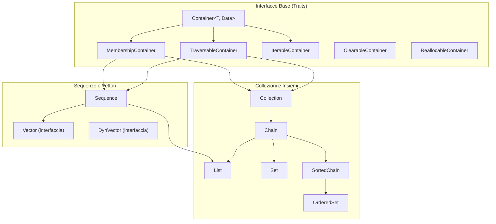

# Laboratorio di Algoritmi e Strutture Dati (LASD) – Proff. M. Benerecetti & F. Mogavero
**Corso di Laurea in Informatica – Università degli Studi di Napoli Federico II**

[](https://openjdk.org/)
[](https://junit.org/junit5/)
[]()
[](https://github.com/UniNa-Fagghino)

Libreria completa e verificata di strutture dati astratte, generiche, sia statiche sia dinamiche, sviluppata in linguaggio **Java** per il superamento dell'esercizio intercorso e dell'esame di **Laboratorio di Algoritmi e Strutture Dati** tenuto dai **Prof. Massimo Benerecetti** e **Prof. Fabio Mogavero**.

Il progetto implementa rigorosamente la gerarchia dei tipi, i vincoli di ereditarietà, i tratti operativi e le complessità asintotiche ottimali specificate nelle 18 tavole di `Diagrams.pdf` e nel documento ufficiale d'esame.

---

## 📌 Indice dei Contenuti

1. [Struttura del Repository](#-struttura-del-repository)
2. [Panoramica dell'Architettura della Libreria (`apsd`)](#-panoramica-dellarchitettura-della-libreria-apsd)
3. [Le 16 Strutture Dati e Complessità Asintotiche](#-le-16-strutture-dati-e-complessità-asintotiche)
4. [Principi di Progettazione Fondamentali](#-principi-di-progettazione-fondamentali)
   - [F-Bounded Polymorphism (CRTP)](#a-f-bounded-polymorphism-crtp)
   - [Buffer Circolari ed Aritmetica Modulare](#b-buffer-circolari-ed-aritmetica-modulare)
   - [Ridimensionamento Dinamico Ammortizzato (Anti-Thrashing)](#c-ridimensionamento-dinamico-ammortizzato-anti-thrashing)
   - [Pattern Adapter (Wrapper per DEQ e Insiemi)](#d-pattern-adapter-wrapper-per-deq-e-insiemi)
5. [Guida alla Compilazione ed ai Test Unitari](#-guida-alla-compilazione-ed-ai-test-unitari)
   - [Ambiente Windows (`winbuild.ps1`)](#ambiente-windows-powershell)
   - [Ambiente Linux / macOS (`Makefile`)](#ambiente-linux--macos-make)
6. [Istruzioni per la Consegna Ufficiale](#-istruzioni-per-la-consegna-ufficiale)
7. [Disclaimer Accademico & Crediti](#-disclaimer-accademico--crediti)

---

## 📁 Struttura del Repository

L'albero dei file del repository è organizzato in modo modulare:

```
├── .gitattributes                    # Normalizzazione line-endings e configurazione Git LFS
├── .gitignore                        # Esclusione bytecode (.class), artefatti IDE e zip di consegna
├── README.md                         # Questa documentazione principale del repository
├── prepara_consegna.ps1              # Script per generare lo zip d'esame "Cognome - Nome - Matricola.zip"
│
├── ProgettoLASD/                     # La directory del progetto Java completo e compilabile
│   ├── Main.java                     # Punto di ingresso dell'applicazione
│   ├── makefile                      # Script di automazione per sistemi Unix (Linux / macOS)
│   ├── winbuild.ps1                  # Script di compilazione e test nativo per Windows PowerShell
│   ├── Diagrams.pdf                  # Tavole ufficiali con diagrammi di classi ed interfacce (18 pag.)
│   ├── readme.md                     # Note originali del template
│   │
│   ├── apsd/                         # Codice sorgente della libreria (Algoritmi e Strutture Dati)
│   │   ├── classes/                  # Implementazioni concrete, classi base e utilità
│   │   │   ├── utilities/            # Natural, MutableNatural, Box
│   │   │   └── containers/
│   │   │       ├── sequences/        # Vector, CircularVector, DynVector, DynCircularVector
│   │   │       ├── collections/      # LLList, VList, LLSortedChain, VSortedChain, WSet, WOrderedSet
│   │   │       └── deqs/             # WStack (Pila), WQueue (Coda)
│   │   │
│   │   └── interfaces/               # Contratti e tratti astratti
│   │       ├── traits/               # Caratteristiche minime (Clearable, Reallocable, Iterable, ecc.)
│   │       └── containers/           # Gerarchie di Container, Sequence, Collection, Set, DEQ
│   │
│   └── zapsdtest/                    # Suite di test JUnit 5 fornita dai docenti
│       ├── simpletest/               # Insieme di 82 test unitari sulle 16 strutture concrete
│       ├── testframework/            # Framework astratto di verifica algebrica e proprietà (invariato)
│       └── zjunit/                   # JAR standalone e librerie di JUnit 5 Platform Console
│
└── Traccia_e_Materiale_Ufficiale/    # Documentazione fornita dai docenti per l'appello
    ├── Exercise.pdf                  # Traccia ufficiale del progetto intercorso
    ├── Template.zip                  # Archivio ZIP originale distribuito dai docenti
    ├── messaggio_prof.md             # Istruzioni e bando d'esame formattati in Markdown
    └── text.txt                      # Testo originale del messaggio dei docenti
```

---

## 🏛 Panoramica dell'Architettura della Libreria (`apsd`)

La libreria segue rigorosamente la separazione tra **interfacce astratte** (che specificano proprietà algebriche e contratti) e **classi concrete** (che definiscono la rappresentazione fisica della memoria):



---

## ⚡ Le 16 Strutture Dati e Complessità Asintotiche

Il progetto include 16 strutture dati concrete, suddivise in vettori lineari/circolari, liste concatenate, catene ordinate e collezioni wrapper:

| # | Struttura Dati Concreta | Rappresentazione Fisica | Accesso `GetAt(i)` | Inserimento Testa | Inserimento Coda | Ricerca `Search(x)` | Minimo / Massimo |
| :---: | :--- | :--- | :---: | :---: | :---: | :---: | :---: |
| **01** | `Vector` | Array statico lineare | $O(1)$ | $O(n)$ | $O(n)$ | $O(n)$ | $O(n)$ |
| **02** | `CircularVector` | Array statico circolare | $O(1)$ | $O(1)$ | $O(1)$ | $O(n)$ | $O(n)$ |
| **03** | `DynVector` | Array dinamico lineare | $O(1)$ | $O(n)$ | $O(1)$ amm. | $O(n)$ | $O(n)$ |
| **04** | `DynCircularVector` | Array dinamico circolare | $O(1)$ | $O(1)$ amm. | $O(1)$ amm. | $O(n)$ | $O(n)$ |
| **05** | `VList` | Vettore dinamico circolare | $O(1)$ | $O(1)$ amm. | $O(1)$ amm. | $O(n)$ | $O(n)$ |
| **06** | `LLList` | Nodi concatenati (`LLNode`) | $O(i)$ | $O(1)$ | $O(1)$ | $O(n)$ | $O(n)$ |
| **07** | `VSortedChain` | Vettore circolare ordinato | $O(1)$ | $O(n)$ | $O(n)$ | $O(\log n)$ *(dicotomica)* | $O(1)$ |
| **08** | `LLSortedChain` | Nodi concatenati ordinati | $O(i)$ | $O(n)$ | $O(n)$ | $O(n)$ | $O(1)$ |
| **09** | `VStack` (`WStack` su `VList`) | Pila su vettore circolare | $O(1)$ | $O(1)$ amm. | – | $O(n)$ | – |
| **10** | `LLStack` (`WStack` su `LLList`)| Pila su lista concatenata | $O(1)$ | $O(1)$ | – | $O(n)$ | – |
| **11** | `VQueue` (`WQueue` su `VList`) | Coda su vettore circolare | $O(1)$ | – | $O(1)$ amm. | $O(n)$ | – |
| **12** | `LLQueue` (`WQueue` su `LLList`)| Coda su lista concatenata | $O(1)$ | – | $O(1)$ | $O(n)$ | – |
| **13** | `VSet` (`WSet` su `VList`) | Insieme su vettore circolare| – | $O(n)$ | $O(n)$ | $O(n)$ | – |
| **14** | `LLSet` (`WSet` su `LLList`) | Insieme su lista concatenata | – | $O(n)$ | $O(n)$ | $O(n)$ | – |
| **15** | `VOrderedSet` (`WOrderedSet`) | Insieme ordinato su `VSorted`| – | $O(n)$ | $O(n)$ | $O(\log n)$ | $O(1)$ |
| **16** | `LLOrderedSet` (`WOrderedSet`) | Insieme ordinato su `LLSorted`| – | $O(n)$ | $O(n)$ | $O(n)$ | $O(1)$ |

---

## 🧠 Principi di Progettazione Fondamentali

### A. F-Bounded Polymorphism (CRTP)
Tutte le interfacce e classi astratte usano il polimorfismo vincolato:
```java
public interface Container<T extends Container<T, Data>, Data>
```
Questo garantisce che metodi algebrici come `T Empty()` o unione/intersezione restituiscano esattamente il tipo concreto dell'oggetto invocante (ad esempio un `VList<Data>` restituisce un `VList<Data>`, non un tipo generico degradato), prevenendo cast insicuri a runtime.

### B. Buffer Circolari ed Aritmetica Modulare
Nei vettori circolari (`CircularVectorBase`), la testa della sequenza `head` si sposta liberamente all'interno dell'array fisico. La traduzione dall'indice logico `pos` all'indice fisico dell'array avviene in tempo $O(1)$ tramite:
$$\text{physicalIndex} = (\text{head} + \text{pos}) \pmod{\text{capacity}}$$
L'inserimento in testa decrementa modularmente `head`:
$$\text{head} = (\text{head} - 1 + \text{capacity}) \pmod{\text{capacity}}$$
evitando il costo di shift $O(n)$ tipico degli array lineari.

### C. Ridimensionamento Dinamico Ammortizzato (Anti-Thrashing)
Nei vettori dinamici:
1. **Espansione ($2\times$)**: Quando il vettore è saturo ($size == capacity$), la capacità raddoppia. L'inserimento ha costo ammortizzato costante $O(1)$.
2. **Contrazione ($1/4$)**: Quando la dimensione scende a un quarto della capacità ($size \le capacity / 4$), la capacità viene dimezzata.
> **Perché non dimezzare a metà ($1/2$)?**  
> Se si dimezzasse a $1/2$, un'alternanza di inserimento e cancellazione a cavallo della soglia forzerebbe una riallocazione e copia dell'intero array a ogni singola operazione (*thrashing*), degradando il costo medio da $O(1)$ a $O(n)$. Con la soglia a $1/4$, dopo il dimezzamento il vettore rimane occupato a metà ($1/2$), garantendo un margine di almeno $n/4$ rimozioni o $n/2$ inserimenti prima della successiva riallocazione.

### D. Pattern Adapter (Wrapper per DEQ e Insiemi)
`WStack`, `WQueue`, `WSet` e `WOrderedSet` applicano il **Design Pattern Adapter**: incapsulano una sequenza o catena sottostante delegandovi le operazioni primarie (`Push`, `Pop`, `Enqueue`, `Dequeue`, `InsertIfAbsent`) senza duplicare la gestione della memoria.

---

## 🛠 Guida alla Compilazione ed ai Test Unitari

### Ambiente Windows (PowerShell)
Dalla cartella [`ProgettoLASD`](ProgettoLASD):

```powershell
# 1. Compila il codice principale e i test
.\winbuild.ps1

# 2. Esegue tutti gli 82 test unitari della suite SimpleTest
.\winbuild.ps1 runtest

# 3. Esegue la classe Main
.\winbuild.ps1 run

# 4. Rimuove tutti i file compilati .class
.\winbuild.ps1 clean
```

### Ambiente Linux / macOS (`make`)
Dalla cartella [`ProgettoLASD`](ProgettoLASD):

```bash
# 1. Compila i sorgenti
make main

# 2. Esegue i test con JUnit Platform Console
make runtest

# 3. Esegue la classe Main
make run

# 4. Pulisce i file .class
make clean
```

---

## 📦 Istruzioni per la Consegna Ufficiale

Il bando d'esame prescrive tassativamente che l'elaborato da consegnare consista in:
> *Un unico file ZIP contenente una cartella avente nome coerente con il formato `Cognome - Nome - Matricola`, al cui interno dovranno essere presenti le sole cartelle `apsd` e `zapsdtest` e i due file `Main.java` e `makefile`.*

Per automatizzare questa procedura senza rischiare penalizzazioni per file eccedenti (come script personali, binari `.class` o diagrammi), è fornito lo script [`prepara_consegna.ps1`](prepara_consegna.ps1):

```powershell
# Esempio di utilizzo:
.\prepara_consegna.ps1 -Cognome "Rossi" -Nome "Mario" -Matricola "N86001234"
```

Lo script provvederà in automatico a:
1. Eseguire la pulizia preventiva di tutti i file `.class`;
2. Creare la cartella `Rossi - Mario - N86001234`;
3. Copiare unicamente `apsd/`, `zapsdtest/`, `Main.java` e `makefile`;
4. Comprimere il pacchetto nel file finale `Rossi - Mario - N86001234.zip`.

---

## ⚖️ Disclaimer Accademico & Crediti

* I requisiti del progetto, le convenzioni dei diagrammi (`Diagrams.pdf`) e la suite di verifica `zapsdtest` sono proprietà intellettuale dei **Proff. Massimo Benerecetti & Fabio Mogavero** (Università degli Studi di Napoli Federico II).
* La presente implementazione è stata sviluppata a scopo didattico e di studio collaborativo.
* **Curatore:** [Fagghino](https://github.com/Fagghino) – Organizzazione [UniNa-Fagghino](https://github.com/UniNa-Fagghino).

